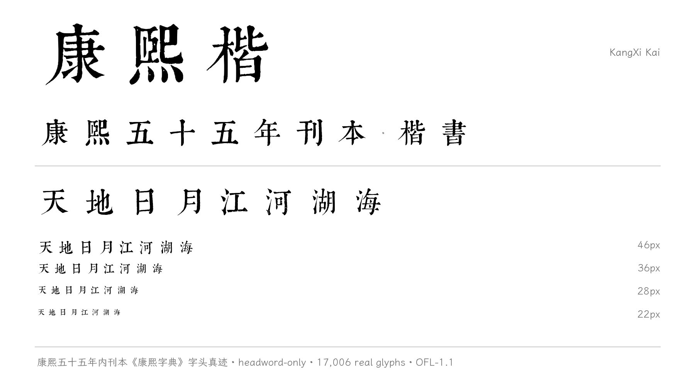
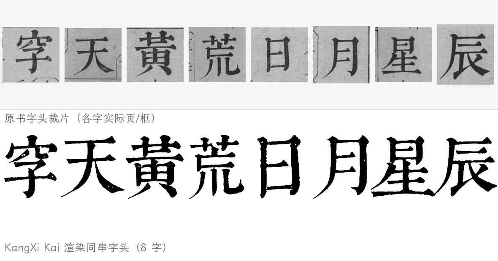
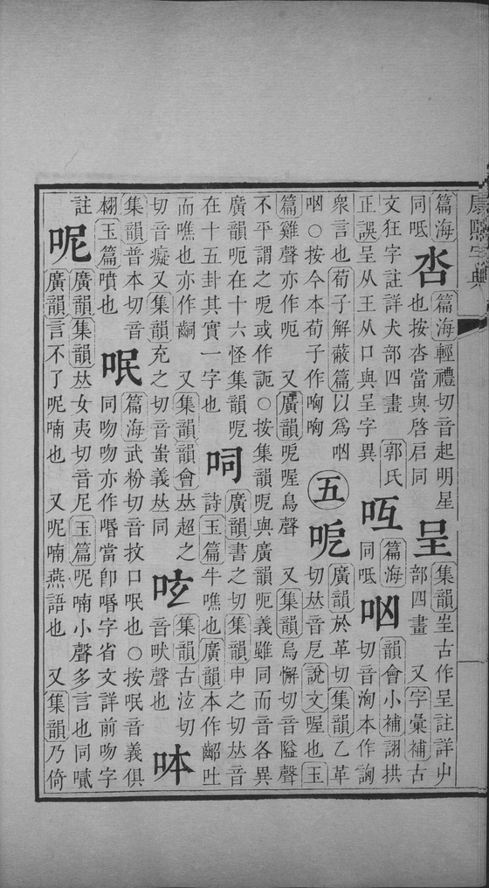
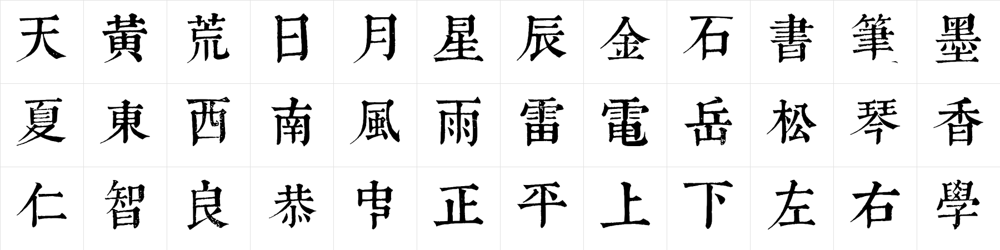

# 康熙楷 KangXi Kai

> 一套从《康熙字典》康熙五十五年内府刊本重建的**字头真迹**楷书字体。
> An open-source Kaishu typeface built from the *headword* glyphs of the 1716 Kangxi Dictionary woodblock print.

<p align="center">
  
</p>

> **状态：v2.6.2（2026-11-13）** —— 17,005 个真实字头字形，全部取自刻本真迹，无生成字。
> 本项目为**字头精选集**（非全字库）；覆盖、限制与发布条件见
> [覆盖范围](#覆盖范围与限制) 与 [docs/releases/v2.6.2/KNOWN-DEBTS.md](docs/releases/v2.6.2/KNOWN-DEBTS.md)。

## 这是什么

《康熙字典》是清康熙五十五年（1716）内府刊行的大型字书。它的**字头**以楷书大字刻印：
结体端严、横细竖粗、起收分明，既有官刻的规整，也保有雕版刻工的刀意，是研究清代楷书
与雕版字体的一手材料。

本项目把每一页的字头（占 2×2 个小字格的大字）逐字切出、二值化、矢量化、归一化，
做成一套可安装、可再分发的 CJK 楷书字体。它的特点是：

- **真迹，不是仿写**：每个字形都来自刻本字头的实际墨迹；不做 OCR 补字、不补假字形、不收注文小字；
- **切前排除版面**：版框、界行、页边黑带、注文残线在裁切阶段用页级几何 + pre-cut mask 排除，
  而不是切进来后再用启发式擦除；
- **可追溯**：每个字都能回溯到「册/页/半版/框坐标」，mapping、几何、闸报告随版本落盘；
- **参考字体只用于 QA**：霞鹜文楷（LXGW WenKai，OFL）仅作独立对比参考，不参与字形生成。

## 原书与字体

上行是刻本上的字头原样（各字来自其实际页/框），下行是同一串字用本项目字体渲染的结果：

<p align="center">
  
</p>

原书右半版（字头大字 + 注文小字；本项目只取字头）：

<p align="center">
  
</p>

## 字形示例

<p align="center">
  
</p>

## 字体规格

| 项目 | 内容 |
|---|---|
| 家族名 | KangXi Kai（康熙楷） |
| 字形 | **17,005** 个，全部为刻本字头真迹（headword-only） |
| 格式 | TTF（glyf，UPM 1000） |
| 覆盖 | CJK 基本区 10,267 / 20,992 = **48.91%**；目标字表 10,267 / 16,567 = **61.97%** |
| 缺口 | 6,300 字（含部分常用字，见下文） |
| 字符集 | 仅汉字；不含标点、数字、拉丁字母（由排版软件回退） |
| 数据源 | 《康熙字典》清康熙五十五年内府刊本，[書格 shuge.org](https://shuge.org) 数字化（14 册 / 3,869 页） |
| 授权 | 字体 SIL Open Font License 1.1（[OFL.txt](OFL.txt)）；代码 MIT（[LICENSE](LICENSE)） |
| 构建 | Python + PyMuPDF + OpenCV + potrace + fontTools（可复现） |

## 字形怎么来的

```
PDF 扫描（14 册 / 3,869 页）
   ↓  S1 页级几何：格点拟合 + 正文区（content quad）+ 版框/界行检测
   ↓  S2 mapping：正典序 → 页/半版 → 2×2 字头格块（框 = 2×2 块 ∩ 正文区）
   ↓  S3 裁切：pre-cut 页级 mask（版框/界行/页边黑带/注文残线）→ 二值化
   ↓  S3 矢量化：2×2 块掩膜 → 主簇清理 → potrace 轮廓
   ↓  S3 归一化：字墨 bbox 最长边 → 760 font units（UPM 1000）
   ↓  S4 闸：font_qa / 字形级框线 / 内容 / 缺件 / 框线逃逸 / 页级几何 / provenance
KangXiKai-Regular-v2.6.2.ttf
```

管线细节与复现命令见 [docs/PIPELINE.md](docs/PIPELINE.md)；流程纪律（候选/正式分层、闸、里程碑）
见 [docs/WORKFLOW.md](docs/WORKFLOW.md)。

## 覆盖范围与限制

- **不是全字库**：目标表 16,567 字中已收 10,267 字（61.97%），缺口 6,300 字，含
  一/件/你/內/合/在/多/張/教/樣/氣/法/清/為/王/相/種/臺/與/被/裡/都/間 等常用字；
  缺字由排版软件自动回退系统字体。
- **仅字头**：只收字头大字，不收注文小字、不补假字形（部分注文中的字形不在字库内）。
- **少量已知缺陷**：11 字的 mapping 标签待重定位、165 个缺件扫描项、1,173 个半版（页）尚未完成字头定位，
  正在 2.6.x 补丁线修复；逐项披露见 [docs/releases/v2.6.2/KNOWN-DEBTS.md](docs/releases/v2.6.2/KNOWN-DEBTS.md)。
- **不含标点/数字/拉丁字母**；缺字自动回退系统字体。

## 安装与使用

1. 下载发布包 `KangXiKai-v2.6.2.zip`，解压后安装 `KangXiKai-Regular-v2.6.2.ttf`；
2. 在排版软件中选择家族名 **KangXi Kai** / Regular；
3. 缺字（含拉丁字母、标点）由系统字体自动回退。

```text
康熙字典　楷書字頭
```

## 构建与复现

```bash
# 字体构建（10 workers，全量约 10.5 分钟；缓存命中约 4 分钟）
FONT_BUILD_WORKERS=10 .venv/bin/python scripts/font_build.py \
  --mapping work/lead/mapping_block_v271.jsonl \
  --out work/font/build/KangXiKai-v2.6.2.ttf --version 2.6.2

# 快闸
.venv/bin/python scripts/fast_gate.py --font work/font/build/KangXiKai-v2.6.2.ttf \
  --manifest work/font/build/manifest_v262.json --version 2.6.2 \
  --baseline work/font/build/KangXiKai-v2.5.8.ttf \
  --baseline-manifest work/font/build/manifest_v258.json --content-max-damaged 35

# 全闸（发布候选；扫描可复用已绑定结果）
.venv/bin/python scripts/release_gate.py --version 2.6.2 \
  --font work/font/build/KangXiKai-v2.6.2.ttf --manifest work/font/build/manifest_v262.json \
  --prev work/font/build/KangXiKai-v2.5.8.ttf --prev-manifest work/font/build/manifest_v258.json \
  --content-max-damaged 35 --tag v262
```

构建输入（mapping / 页级几何 / 线条带）、缓存版本规则与闸定义见 [docs/PIPELINE.md](docs/PIPELINE.md)。

## 项目结构

完整架构、目录职责与「新增文件放哪里」见 **[docs/ARCHITECTURE.md](docs/ARCHITECTURE.md)**；技术路线见 [docs/METHOD.md](docs/METHOD.md)。

```text
kangxizidian/
├── scripts/            代码：顶层 28 个 = 现行管线；oneoff/ 一次性脚本；provenance/ 数据 provenance；_archive/ 冻结历史
├── docs/               文档：架构(ARCHITECTURE) / 方法(METHOD) / 管线(PIPELINE) / 决策 / 计划 / 发布记录(releases/)
├── work/               工作区（gitignored）：mapping/几何真源、构建产物、闸证据、复核材料（见 docs/reference/WORK-MAP.md）
├── release/            正式发布包（gitignored；只放正式包）
├── audit/              审计报告与证据
├── data/               参考数据（字表/Unicode/认证样本；部分 gitignored）
└── 康熙字典/           扫描源 PDF（12G，gitignored，不随仓库分发）
```

## 许可

- **字体**（`*.ttf` 及发布包内字体）：SIL Open Font License 1.1，见 [OFL.txt](OFL.txt)；
- **代码与文档**（`scripts/`、`docs/`）：MIT，见 [LICENSE](LICENSE)；
- 扫描件版权归原收藏 / 数字化机构，本项目不随包分发扫描图；
- 参考字体 LXGW WenKai（OFL）不随本包分发，其 Reserved Font Name 未被使用。

## 数据来源与致谢

- 扫描件：《康熙字典》清康熙五十五年内府刊本，[書格 shuge.org](https://shuge.org) 数字化；
  本文档中的书影与对比图取自该数字化扫描件，仅用于项目说明（版权归原收藏/数字化机构）；
- 参考字体：[霞鹜文楷 LXGW WenKai](https://github.com/lxgw/LxgwWenKai)（OFL 1.1），仅用于独立对比与 QA；
- 工具链：Python + PyMuPDF + OpenCV + potrace + fontTools。

## 文档导航

| 文档 | 内容 |
|---|---|
| [docs/ARCHITECTURE.md](docs/ARCHITECTURE.md) | **项目架构 / 文件夹层级 / 依赖方向 / 新增文件放哪里** |
| [docs/METHOD.md](docs/METHOD.md) | 技术路线（可读版） |
| [docs/PROJECT-STATE.md](docs/PROJECT-STATE.md) | 30 秒现状、已知缺陷、独立审计命令 |
| [docs/PIPELINE.md](docs/PIPELINE.md) | 现行管线（唯一权威） |
| [docs/WORKFLOW.md](docs/WORKFLOW.md) | 候选/正式分层、闸分层、里程碑发版纪律 |
| [docs/reference/RELEASE-METRICS.md](docs/reference/RELEASE-METRICS.md) | 版本对比指标与发版判据 |
| [docs/releases/v2.6.2/KNOWN-DEBTS.md](docs/releases/v2.6.2/KNOWN-DEBTS.md) · [docs/releases/v2.6.2/SELF-AUDIT.md](docs/releases/v2.6.2/SELF-AUDIT.md) | 本版已知债披露 · 发布前自审计 |
| [docs/VERSION-HISTORY.md](docs/VERSION-HISTORY.md) | 逐版变更 |
| [docs/releases/](docs/releases/README.md) | 正式版发布记录（v2.6.2 起每版一份） |
| [docs/reference/EXPERIMENTS.md](docs/reference/EXPERIMENTS.md) | 实验与探索索引（含失败实验，像馆阁体 EXPERIMENTS） |
| [docs/plans/PLAN-v2.6.3.md](docs/plans/PLAN-v2.6.3.md) · [docs/plans/PLAN-v2.7.0.md](docs/plans/PLAN-v2.7.0.md) | 后续版本计划（v2.7.0：GAN + 带状扫掠生成/回退） |
| [docs/DECISIONS.md](docs/DECISIONS.md) · [docs/ERRATA.md](docs/ERRATA.md) · [docs/BACKLOG.md](docs/BACKLOG.md) | 口径决策 / 更正记录 / 唯一待办清单 |
